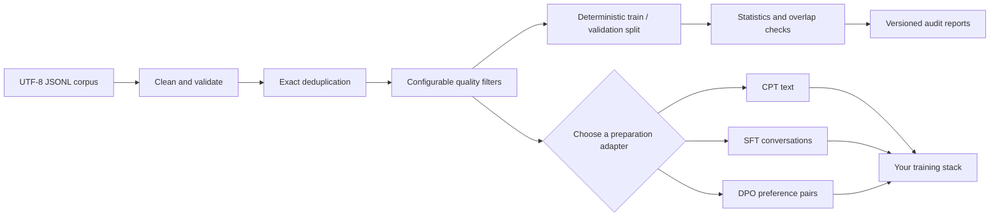

# LLM Data Lab

**Reproducible data preparation and quality checks for language-model datasets.**

[](https://github.com/Imkumar80/llm-data-lab/actions/workflows/tests.yml)
[](https://www.python.org/)
[](LICENSE)

LLM Data Lab helps researchers inspect, clean, split, and prepare JSONL corpora for existing training tools. Reports record what was read, what was written, why records were rejected, and the configuration used. Training stays in Transformers, TRL, or another training library.

The project grew from data curation work in [KannadaSLM](https://github.com/Imkumar80/KannadaSLM). Language-specific rules are configurable and are not applied as universal defaults.

## What it does



Each step reads and writes JSONL so intermediate data stays inspectable. Reports capture counts, checksums, configuration, and rejection reasons. The core prepares data; your existing training stack owns packing, training, and evaluation.

| If you need to… | Start here |
| --- | --- |
| Clean, deduplicate, filter, and split a corpus | [Prepare and inspect a corpus](#prepare-and-inspect-a-corpus) |
| Measure tokens using a tokenizer | [Tokenizer-aware statistics](#tokenizer-aware-statistics) |
| Export CPT, SFT, or DPO training examples | [Prepare training data](#prepare-training-data) |
| Understand input/output fields and report contracts | [Data schemas](docs/data_schemas.md) |
| Understand package boundaries | [Architecture](docs/architecture.md) |
| Reproduce the public data-quality experiment | [AG News ablation](docs/ag_news_ablation_report.md) |

## Capabilities at a glance

- **Core with no runtime dependencies:** streaming JSONL validation, conservative cleanup, exact deduplication, configurable filters, and stable seeded splits.
- **Auditable by design:** SHA-256 checksums, row counts, operation settings, and versioned reports; rejected document contents are not copied into reports.
- **Optional tokenizer support:** token counts and task-specific export validation without making Transformers a core dependency.
- **Bring your own trainer:** preparation adapters and handoff examples work with existing Transformers/TRL workflows; no custom training loop is included.

## Get started

Requires Python 3.10 or newer. Install the core and development tools in an editable environment:

```bash
python -m venv .venv
# Linux or macOS
source .venv/bin/activate
# Windows PowerShell
# .venv\Scripts\Activate.ps1
python -m pip install -e ".[dev]"
```

Input and output files use UTF-8 JSONL: one JSON object per line. Most core commands use a `text` field by default, preserve other fields, and do not need extra packages.

For example, start with `data/raw.jsonl`:

```json
{"text":"A short example document.","source":"sample"}
{"text":"Another document.","source":"sample"}
```

## Prepare and inspect a corpus

Run the core stages explicitly so each intermediate file can be inspected or reused:

```bash
llm-data-lab clean --input data/raw.jsonl --output data/cleaned.jsonl
llm-data-lab dedupe --input data/cleaned.jsonl --output data/deduped.jsonl
llm-data-lab filter --input data/deduped.jsonl --output data/filtered.jsonl --min-chars 200 --max-chars 100000 --min-unique-word-ratio 0.30
llm-data-lab split --input data/filtered.jsonl --train data/train.jsonl --validation data/validation.jsonl --val-fraction 0.02 --seed 42
llm-data-lab stats --input data/filtered.jsonl --output reports/corpus_stats.json
llm-data-lab overlap --split train=data/train.jsonl --split validation=data/validation.jsonl --normalization exact --output reports/overlap.json
llm-data-lab manifest --input data/raw.jsonl --output reports/run_manifest.json --run-name baseline --seed 42 --pipeline-config '{"steps":["clean","dedupe","filter","split"]}'
```

The filter options above are examples, not recommended universal thresholds. Review the rejection report and sample rejected rows before selecting rules for a real corpus. Filtering uses general-purpose length and repetition heuristics; it does not detect language.

Train and validation files should be split after exact deduplication, then checked for overlap. The splitter is deterministic for a given set of documents and seed. It assigns documents using a stable text hash, so assignment does not depend on input order.

## Tokenizer-aware statistics

Install the optional Transformers integration to count tokens with a local tokenizer or model ID:

```bash
python -m pip install -e ".[transformers]"
llm-data-lab stats --input data/filtered.jsonl --tokenizer /path/to/tokenizer --tokenizer-revision abc123 --output reports/token_stats.json
```

The tokenizer revision is optional; pin it when using a remote model ID for reproducibility. Token counts do not add special tokens. Empty or whitespace-only text has zero tokens. Errors identify the record number without printing its contents. The Python API also accepts a tokenizer with `encode(text, add_special_tokens=False)` or a compatible callable.

## Prepare training data

These adapters validate and export data; they do not train a model. Install Transformers for tokenizer loading. You can also pass a tokenizer object directly to the Python API.

**Causal pretraining (CPT)** accepts raw text records and enforces per-document sequence limits plus an optional total token budget:

```bash
llm-data-lab cpt-prepare --input data/filtered.jsonl --output data/cpt.jsonl --tokenizer /path/to/tokenizer --max-sequence-length 256 --token-budget 200000 --overflow-policy truncate --report reports/cpt.json
```

**Supervised fine-tuning (SFT)** accepts records with a `messages` array and requires a tokenizer chat template that returns assistant-token masks:

```bash
llm-data-lab sft-prepare --input data/conversations.jsonl --output data/sft.jsonl --tokenizer /path/to/chat-tokenizer --max-sequence-length 1024 --overflow-policy drop --report reports/sft.json
```

**Direct preference optimization (DPO)** accepts `prompt`, `chosen`, and `rejected` strings:

```bash
llm-data-lab dpo-prepare --input data/preferences.jsonl --output data/dpo.jsonl --tokenizer /path/to/tokenizer --max-sequence-length 1024 --conflict-policy report --report reports/dpo.json
llm-data-lab dpo-overlap --split train=data/dpo_train.jsonl --split validation=data/dpo_validation.jsonl
```

See [data schemas and report contracts](docs/data_schemas.md) for fields, overflow behavior, and Python examples. Optional [TRL handoff examples](examples/trl_integrations/README.md) show how to pass prepared data to existing SFT and DPO trainers. The pinned [CPT smoke example](examples/cpt_smoke/README.md) is an opt-in GPU integration run, not a required install or unit test.

## Split overlap checks

`overlap` compares exact text across two or more named splits and reports overlap counts and affected split names, never raw documents. Choose one of these explicit policies:

- `exact` (default): compare text as-is.
- `nfc_casefold_whitespace`: apply Unicode NFC normalization, case folding, and whitespace collapsing before comparison.

These checks detect exact text overlap under the chosen policy. They do not detect semantic similarity, paraphrases, or whether a document appeared in model pretraining.

## Reports and reproducibility

Where applicable, cleaning, deduplication, filtering, splitting, token statistics, overlap checks, and adapter reports record SHA-256 input/output checksums, row counts, configuration, and software or tokenizer metadata. Rejection reports summarize reasons and counts without embedding raw examples. New token-statistics, overlap, and adapter report formats declare `schema_version: 1`; existing report keys remain available as audit fields are added.

Deduplication is exact after cleaning; it is not semantic deduplication. Keep source dataset names, revisions, licenses, and checksums with your run records. Do not commit private or licensed data, model weights, credentials, or generated checkpoints.

Corpus statistics and data-quality reports describe the data. They do not establish that preprocessing improves model quality; that requires a controlled, held-out model evaluation.

## Current scope and next steps

Implemented today:

- Streaming JSONL validation, conservative text cleanup, exact deduplication, configurable filtering, and deterministic splitting.
- Corpus statistics, optional tokenizer-aware token counts, exact split-overlap checks, checksums, and manifests.
- Preparation-only CPT, SFT, and DPO adapters with synthetic offline tests.
- A pinned public-data ablation and optional examples for handing prepared data to existing trainers.

The next milestone is a small, reproducible CPT training integration run. It is documented in the [CPT smoke example](examples/cpt_smoke/README.md), but requires the optional training dependencies and a compatible GPU. SFT and DPO trainer integrations remain examples; there is no custom training loop, orchestration service, dashboard, distributed-training support, or RLHF implementation in the core.

For package boundaries and adapter contracts, see [architecture](docs/architecture.md) and [data schemas](docs/data_schemas.md). The [AG News ablation report](docs/ag_news_ablation_report.md) describes the public corpus experiment. Longer-term evaluation ideas and recorded design choices are in the [evaluation design](docs/evaluation_design.md) and [decision log](docs/adr/README.md).

## Development

```bash
python -m pytest
ruff check .
```

Tests use small synthetic fixtures and do not download datasets. Use `llm-data-lab --help` or `llm-data-lab COMMAND --help` for the installed CLI's options.

## Origin and license

The initial design is informed by data curation and evaluation work in [KannadaSLM](https://github.com/Imkumar80/KannadaSLM). Kannada-specific script-ratio rules remain project-specific and should be optional rather than universal defaults.

This project is MIT licensed. See [LICENSE](LICENSE).
